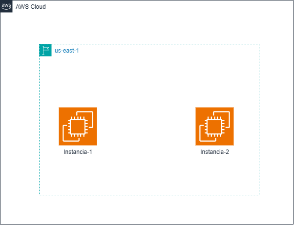

# Exercici 1: Primeres instàncies EC2 amb Terraform

## Objectiu
Creació automatitzada de 2 instàncies EC2 (`t3.micro`) amb Amazon Linux 2023 a la regió `us-east-1` utilitzant Infrastructura com a Codi (IaC) amb Terraform[cite: 1, 2].

## Topologia de Xarxa


## Instruccions d'execució
1. Inicialitzar Terraform (descàrrega de providors):
   ```bash
   terraform init
