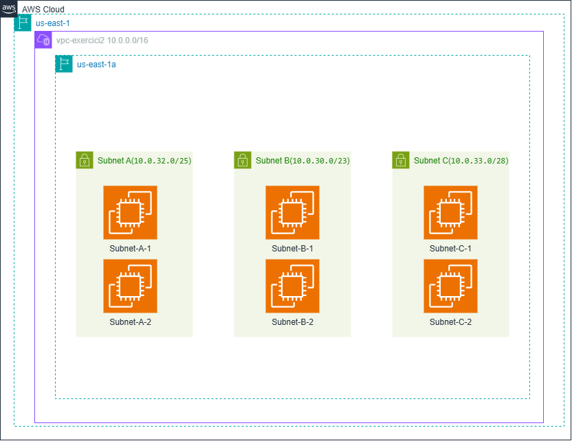
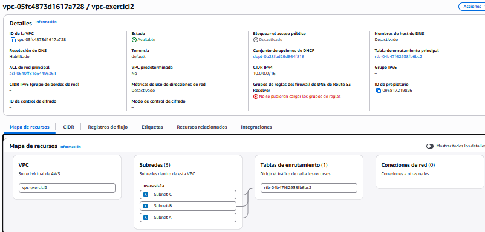
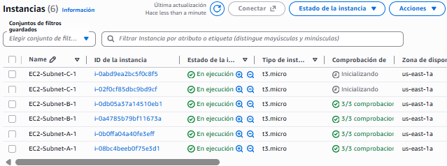

# Exercici 2: Disseny i Desplegament de VPC, Subxarxes i EC2 (Consola + IaC)

## 🎯 Objectiu
Comprendre la segmentació de xarxes a AWS (VPC i Subnets) i comparar el desplegament manual (interfície gràfica d'AWS) amb el desplegament automatitzat mitjançant Terraform.

---

## 🛠️ Part A: Disseny de Xarxa
S'ha dissenyat una VPC personalitzada amb el rang IP `10.0.0.0/16` i tres subxarxes allotjades a la mateixa Zona de Disponibilitat (`us-east-1a`):
* **VPC:** `10.0.0.0/16` (`vpc-exercici2`)
* **Subnet A:** `10.0.32.0/25` (2 instàncies EC2)
* **Subnet B:** `10.0.30.0/23` (2 instàncies EC2)
* **Subnet C:** `10.0.33.0/28` (2 instàncies EC2)

---

## 🖥️ Part B: Desplegament per Consola d'AWS (GUI)
Es va realitzar la creació manual de la VPC i les subxarxes a la consola d'AWS, seguida del llançament de 6 instàncies tipus `t3.micro` amb Amazon Linux 2023 (dos per cada subxarxa).

### Topologia de Xarxa

### VPC i Subxarxes Creades

### Instàncies EC2 en Execució

---

## ⚙️ Part C: Desplegament amb Terraform (IaC)
S'ha preparat el fitxer `main.tf` per automatitzar la infraestructura descrita, assegurant la coherència entre el modelatge manual i el codi d'infraestructura com a codi.
