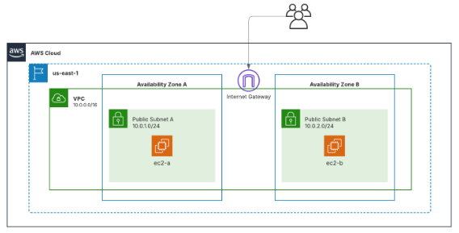
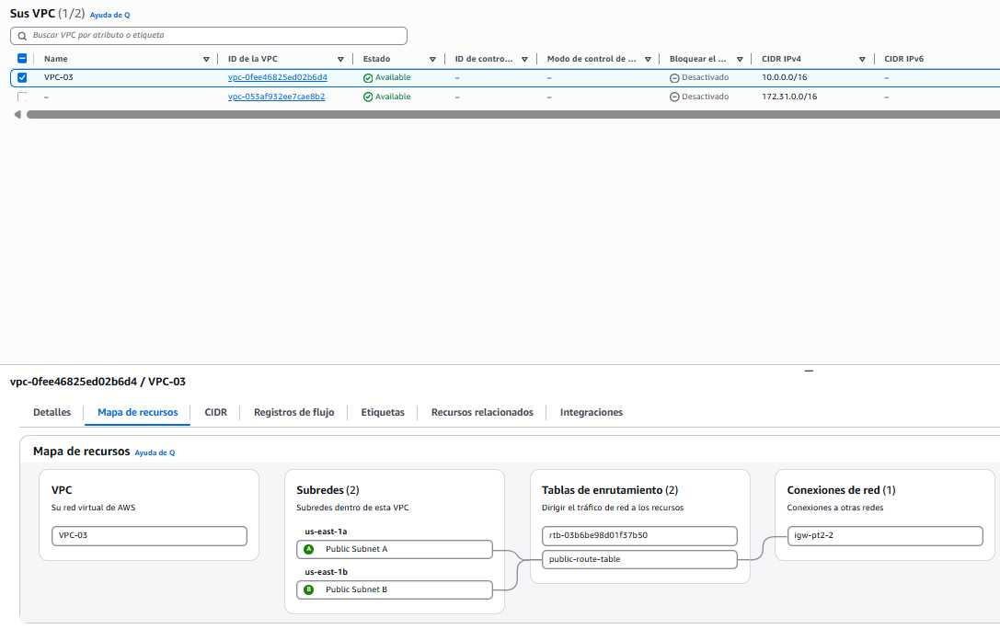
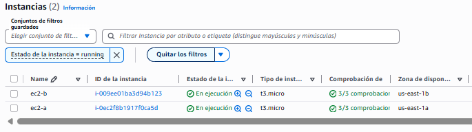

# Pràctica 2.2: Infraestructura a AWS amb Terraform

En aquesta pràctica s'ha automatitzat el desplegament d'una infraestructura bàsica a AWS utilitzant Terraform, seguint els requeriments de l'enunciat.

## Components de la infraestructura
- **VPC (`VPC-03`):** Xarxa amb el bloc CIDR `10.0.0.0/16`.
- **Subxarxes públiques:** 
  - `Public Subnet A` a la zona `us-east-1a` (`10.0.1.0/24`) amb IP pública automàtica.
  - `Public Subnet B` a la zona `us-east-1b` (`10.0.2.0/24`) amb IP pública automàtica.
- **Internet Gateway i Taula de rutes:** Connexió a Internet configurada i associada a les dues subxarxes.
- **Grup de seguretat:** 
  - Accés SSH (`22`) des de qualsevol origen (`0.0.0.0/0`).
  - Trànsit ICMP permès només des del rang de la VPC (`10.0.0.0/16`).
  - Trànsit sortint lliure.
- **Instàncies EC2:** Dues màquines `t3.micro` amb Amazon Linux (`ec2-a` i `ec2-b`), cadascuna en una subxarxa diferent amb la clau `vockey`.
## 📸 Evidències

### Topologia de la xarxa




### VPC i Mapa de Recursos




### Instàncies EC2



## Com executar-ho
1. Inicialitzar Terraform:
   ```bash
   terraform init